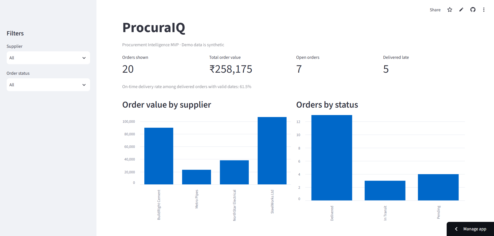
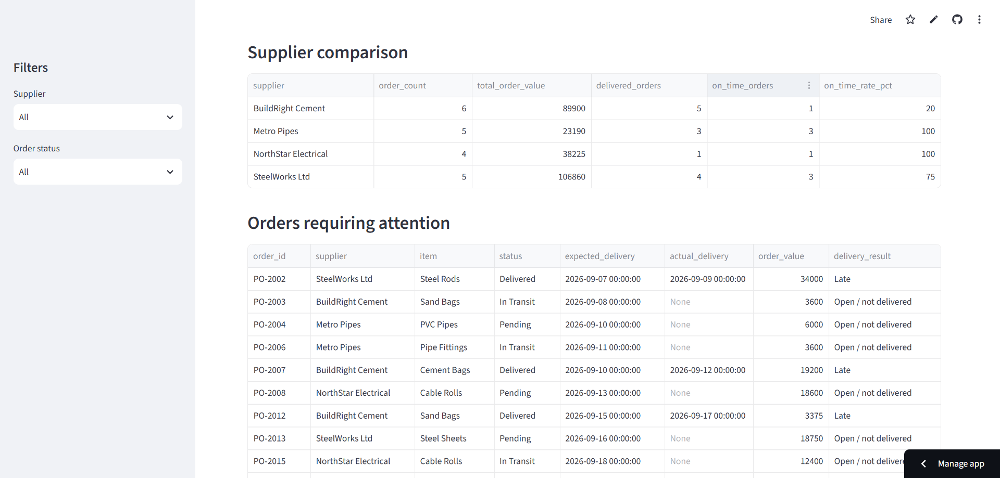
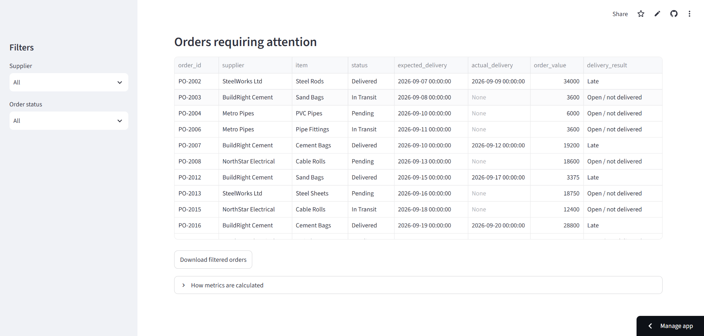

# ProcuraIQ — Procurement Intelligence Dashboard

A Streamlit-based procurement analytics MVP that helps teams monitor purchase orders, compare supplier performance, and identify delivery risks through interactive charts, KPIs, and order-level insights.

## 🚀 Live Demo

**[Open ProcuraIQ Dashboard](https://procuraiq.streamlit.app/)**

## 📊 Dashboard Preview

ProcuraIQ provides an overview of procurement performance, including total order value, open orders, late deliveries, supplier comparisons, and order status.



## 📈 Supplier Comparison

Compare suppliers by order count, total order value, delivered orders, and on-time delivery rate.



## 📋 Orders Requiring Attention

Review individual purchase orders, delivery dates, order status, and late or outstanding deliveries to identify orders that may need follow-up.



## 📌 Key Metrics

- **Total Orders:** 20
- **Total Order Value:** ₹258,175
- **Open Orders:** 7
- **Late Deliveries:** 5
- **On-time Delivery Rate:** 61.5%

*Metrics shown are from the current synthetic demo dataset.*

## ✨ Features

- Filter purchase orders by supplier and order status.
- Track total order value, order count, and open orders.
- Compare supplier performance using order value and delivery metrics.
- Monitor late deliveries and on-time delivery performance.
- Identify outstanding orders requiring attention.
- Download filtered purchase order data.
- Explore how procurement metrics are calculated.

## 🛠️ Tech Stack

- **Language:** Python
- **Dashboard:** Streamlit
- **Data Analysis:** Pandas
- **Visualization:** Interactive charts
- **Data Source:** Synthetic procurement order dataset

## 💻 Run Locally

### 1. Clone the repository

```bash
git clone https://github.com/mohitpal-3069/ProcuraIQ.git
cd ProcuraIQ
```

### 2. Install dependencies

```bash
pip install -r requirements.txt
```

### 3. Run the dashboard

```bash
streamlit run app/app.py
```

## 📁 Project Structure

```text
ProcuraIQ/
├── app/
│   └── app.py
├── data/
├── docs/
├── procurement_orders.csv
├── requirements.txt
├── README.md
├── procuraIQ-dashboard.png
├── procuraIQ-suppliers.png
└── procuraIQ-orders.png
```

## 🎯 Project Objective

ProcuraIQ demonstrates how procurement data can be transformed into actionable insights using KPI monitoring, supplier performance comparisons, and delivery-risk tracking.

The project is an MVP using synthetic data and is intended to demonstrate procurement analytics and dashboard functionality.

---

**Developed by [Mohit Pal](https://github.com/mohitpal-3069)**

**Live Application:** [procuraiq.streamlit.app](https://procuraiq.streamlit.app/) · **Source Code:** [GitHub Repository](https://github.com/mohitpal-3069/ProcuraIQ)
